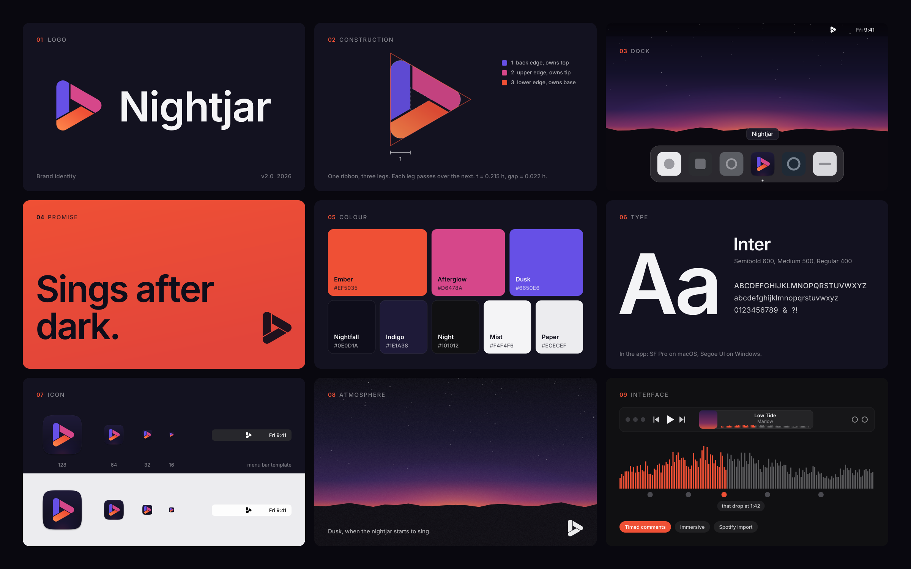

# Nightjar brand

The nightjar is a bird that starts singing at dusk. The mark is a play button made from one ribbon wound round the three sides of a triangle. Each leg runs over the next one at a corner and the next tucks under it, so the loop reads as a single band. The legs step through the colours of a dusk sky: Dusk violet on the back edge, Afterglow rose on the upper edge, Ember on the lower edge.

Everything here is vector SVG built by `source/generate.mjs`. No image model was involved. The rasters (PNG, ICNS, ICO, WebP) are rendered from those SVGs with `rsvg-convert`, `iconutil` and `cwebp`.



## Palette

| Name | Hex | Use |
| --- | --- | --- |
| Ember | `#EF5035` | The accent. Use it for `--accent` in the app, buttons, active states and the lower leg of the mark. |
| Ember Light | `#FF8A4C` | Light end of the gradient on the Ember leg. Not a UI colour. |
| Afterglow | `#D6478A` | Upper leg of the mark. Brand surfaces only, not UI. |
| Dusk | `#6650E6` | Back leg of the mark. Brand surfaces only, not UI. |
| Indigo | `#1E1A38` | Top of the app icon tile. |
| Nightfall | `#0E0D1A` | Bottom of the icon tile, dark brand panels. |
| Night | `#101012` | Window background, dark theme. Unchanged from the app. |
| Mist | `#F4F4F6` | Text and the wordmark on dark backgrounds. |
| Paper | `#ECECEF` | Window background, light theme. |
| Ink | `#121214` | Text and the wordmark on light backgrounds. |

Ember is the one accent. It replaces SoundCloud's `#FF5500`, which the app used before. It is redder, so Nightjar doesn't look like an official SoundCloud app, and it has more contrast on light surfaces:

| Ember `#EF5035` on | Contrast |
| --- | --- |
| Night `#101012` | 5.3 : 1 |
| Light panel `#FBFBFD` | 3.5 : 1 |
| Paper `#ECECEF` | 3.0 : 1 |
| White text on an Ember button | 3.6 : 1 |

That passes WCAG AA for text on the dark theme and the 3 : 1 bar for icons, controls and large text on the light theme. Don't use Ember for small body text on Paper. No single warm colour clears 4.5 : 1 against both `#101012` and `#FBFBFD`.

Dusk and Afterglow belong to the mark and to brand pages. Keep them out of the app UI, so Ember stays the only colour that means "active".

## Type

Inter Semibold (600) for the wordmark and headlines, Medium (500) for labels, Regular (400) for body text. The wordmark is set at -0.02em tracking with the cap height at 60% of the mark's height. Every logo file has the letters converted to outlines, so no font needs to be installed. Inside the app the UI keeps the system font: SF Pro on macOS, Segoe UI on Windows.

## Construction

Build the mark on an equilateral triangle h tall, pointing right.

- Round the outer corners with radius `0.11 h`.
- The ribbon is `t = 0.215 h` wide. Offsetting the rounded triangle inward by `t` cuts the hole, which keeps sharp corners.
- Split the ring into three legs, one per side. The back leg owns the top corner, the upper leg owns the tip, and the lower leg owns the bottom corner. Where a leg tucks under its neighbour it stops `0.022 h` short, cut parallel to the neighbour's inner edge.
- The Ember leg has the only gradient, Ember Light at the bottom corner fading to Ember by three quarters of the way to the tip. Dusk and Afterglow are flat.
- To centre the mark in a square, put the point halfway between the triangle's bounding box centre and its centroid on the square's centre. A box-centred triangle looks like it sits too far left.
- In the app icon the mark is 60% of the tile's height.
- Keep clear space of at least `t` on every side. In the lockup, the gap between mark and wordmark is `0.34 h`.

Small sizes use their own geometry instead of a scaled-down master. The 32 px icon uses a thicker ribbon (`0.25 h`) with wider gaps. The 16 px icon and the 16 and 24 px Windows icons use `0.3 h` and no gaps, so they read as a triangle in three colours. The 16 px menu bar template keeps gaps of about one pixel.

## Usage

- On dark backgrounds use `logo-wordmark.svg`. On light backgrounds use `logo-wordmark-light.svg`. The mark itself stays in colour on both.
- For a single colour, use `src/assets/logo-mark.svg`. It draws in `currentColor` with the legs at 50, 75 and 100% opacity from Dusk to Ember, so the steps survive at 17 px in the idle display.
- For black or white only, such as the menu bar, fill all three legs and keep the gaps.
- Don't put the colour mark on an Ember, Afterglow or Dusk background. Use the single-colour mark in Nightfall, as on the board's tagline panel.
- Don't recolour the legs, change their order, close the gaps at large sizes, or add outlines or effects. Don't rebuild the wordmark in another typeface.
- Don't put the mark on a plain orange tile. SoundCloud's icon is a white mark on an orange square.
- The tagline is "Sings after dark." Use it as written, with the full stop.

## Files

App icons, used by the build (keep these names, the packaging config points at them):

| File | What it is |
| --- | --- |
| `build/icon.svg` | Master macOS icon. Mark on an Indigo to Nightfall tile with a faint Afterglow glow at the foot, 824 px with continuous corners on a 1024 canvas per Apple's grid, drop shadow inside the canvas. |
| `build/icon.png` | 1024 px render of the above. Also the Linux icon. |
| `build/icon.icns` | macOS icon, every size from 16 to 512@2x. The 16 and 32 px slots use the small-size geometry with the back edge snapped to whole pixels. |
| `build/icon.ico` | Windows icon: 16, 24, 32, 48, 64, 128 and 256 px. Near full bleed tile. 16 and 24 use a plain tile and the gapless mark. |
| `build/trayTemplate.png`, `build/trayTemplate@2x.png` | macOS menu bar template, black on transparent, 16 and 32 px. |
| `build/tray.png` | Windows tray icon, colour mark on transparent, 32 px. |
| `build/dmg-background.png`, `build/dmg-background@2x.png` | DMG window background, 540 x 380 and 1080 x 760. The app icon goes at (140, 190) and Applications at (400, 190), both slots left empty. The band behind the Finder labels (y 228 to 262) is a mid-tone mauve, so the black labels of light mode and the white labels of dark mode both stay readable. |

Web and app:

| File | What it is |
| --- | --- |
| `public/favicon.svg`, `public/favicon.png` | Favicon, linked from `index.html`. The PNG is 64 px. |
| `src/assets/logo-mark.svg` | Single-colour mark in `currentColor`. The idle now-playing display, the welcome screen and the account page use it. |
| `web/icons/icon-192.png`, `web/icons/icon-512.png` | PWA icons, rendered from `build/icon.svg`. |
| `web/icons/maskable.svg`, `web/icons/maskable-512.png` | Android maskable icon. Full-bleed tile, the mark inside the central 80% circle. |
| `web/icons/apple-touch-icon.svg`, `web/icons/apple-touch-icon.png` | iOS home screen icon, 180 px, full bleed (iOS rounds the corners). |

Brand:

| File | What it is |
| --- | --- |
| `brand/logo-mark.svg` | Colour mark, transparent background, tight bounds. |
| `brand/logo-wordmark.svg` | Mark and wordmark for dark backgrounds. |
| `brand/logo-wordmark-light.svg` | Mark and wordmark for light backgrounds. |
| `brand/og-image.png` | 1200 x 630 social card. |
| `brand/brand-board.svg`, `brand/brand-board.png` | 3 x 3 brand board, 2400 x 1500. |

Site copies, written by the generator because the site only serves `site/public`: `logo-mark.svg`, `logo-wordmark.svg`, `og-image.png`, `favicon.svg`, `favicon.png`, `apple-touch-icon.png` (the full-bleed iOS icon) and `img/app-icon.webp` (256 px, from `build/icon.svg`).

Source:

| File | What it is |
| --- | --- |
| `brand/source/geometry.mjs` | Polygon offset and boolean helpers (clipper-lib). Rounding and gaps are real geometry, so every SVG is plain filled paths. |
| `brand/source/mark.mjs` | Mark geometry, plus the two concepts it was compared with. |
| `brand/source/generate.mjs` | Builds every file above. |
| `brand/source/check.mjs` | Unpacks the ICNS, lays the small sizes out at 1:1 and 4x, previews the maskable icon under a circle mask, and draws Finder-style labels on the DMG background in both modes. |
| `brand/source/concepts.mjs`, `brand/source/concepts/` | The three concepts: A Prism (three translucent ribbons along the edges), B Fold (one ribbon wound round the triangle, chosen), C Wing (a play shape with an ember crescent and a tail). `sheet.png` compares them at 1024, 128, 32 and 16 px on dark and light. `sheet-small.png` shows 32 and 16 px at 6x. |
| `brand/source/og-image.svg`, `brand/source/dmg-background.svg`, `brand/source/icon-windows*.svg` | Vector sources for the rasters above. |

## Regenerating

```sh
npm install --no-save opentype.js @fontsource/inter png-to-ico clipper-lib
node brand/source/generate.mjs
node brand/source/concepts.mjs   # optional
node brand/source/check.mjs      # optional, writes /tmp/nightjar-*.png
```

You need `rsvg-convert` (`brew install librsvg`), `cwebp` (`brew install webp`), and `iconutil` for the ICNS, so this runs on macOS. `--no-save` keeps the tools out of `package.json`. The next plain `npm install` removes them again.
